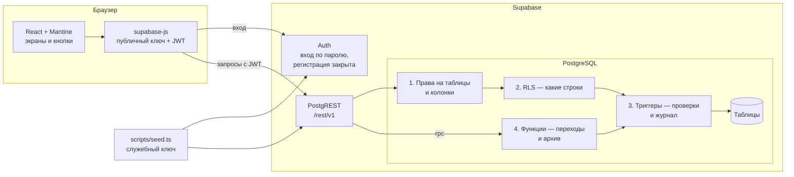
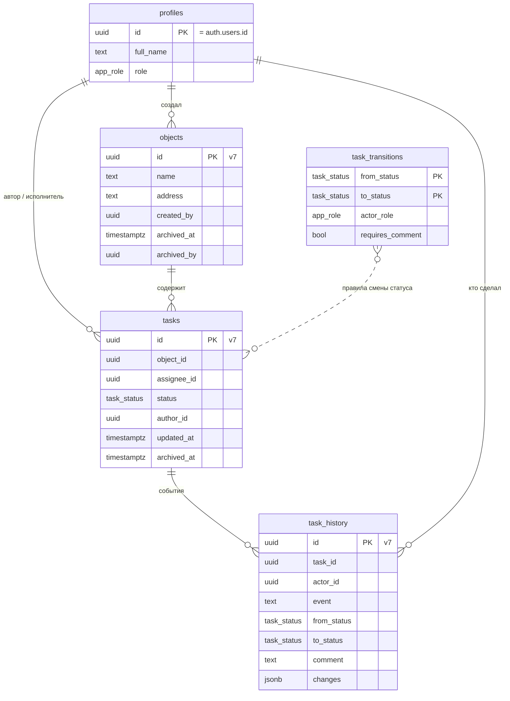
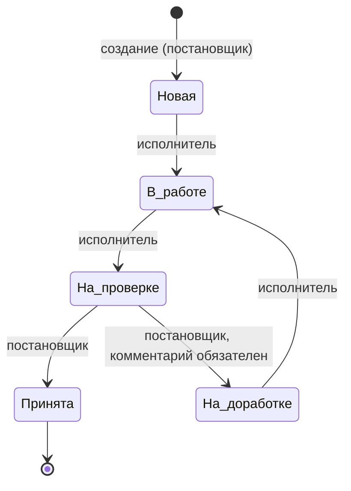
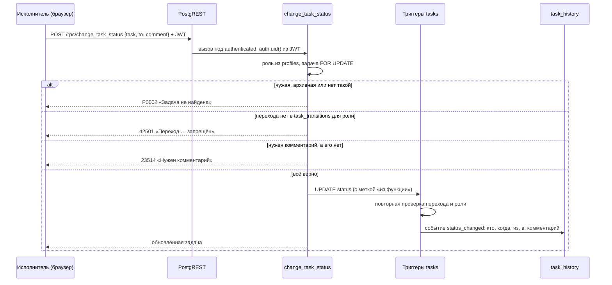

# Архитектура

## Смысл и цель

Мини-CRM для учёта задач на объектах. Цель проекта — показать систему, в которой **права держит база данных**: интерфейс только показывает и вызывает то, что база разрешает. Отсюда три следствия, на которых построено всё остальное:

1. Обойти правила, отправив запрос в API мимо интерфейса, нельзя — проверка в базе срабатывает для любого клиента.
2. Правило записано в одном месте. Например, разрешённые переходы статусов лежат в таблице `task_transitions`: по ней проверяет база и по ней же интерфейс строит кнопки.
3. Каждое правило покрыто тестом, который пытается его нарушить и ожидает отказ.

## Компоненты

- **Фронтенд** (Vercel): статическое SPA. Знает только адрес проекта и публичный ключ. Роль пользователя берёт из таблицы `profiles` лишь для того, чтобы решить, какие кнопки показать.
- **Supabase Auth**: вход по email и паролю. Регистрация отключена; пользователей заводит администратор.
- **PostgREST**: превращает HTTP-запросы в SQL и выполняет их под ролью `authenticated` с идентификатором пользователя из JWT. Отсюда вся проверка — в базе.
- **PostgreSQL**: схема, права, политики, триггеры и функции. Всё лежит в `supabase/migrations` и применяется одной командой.
- **Скрипт заполнения**: единственное место, где используется служебный ключ, — заведение пользователей и профилей. Объекты и задачи он создаёт уже от имени настоящих пользователей.

## Модель данных

| Таблица | Что хранит | Кто пишет |
|---|---|---|
| `profiles` | Имя и роль, `id` = id пользователя в Auth | Только администратор (скрипт или SQL) |
| `objects` | Название, адрес, кто создал, архивная отметка | Постановщик; архив — функцией `archive_object` |
| `tasks` | Название, описание, объект, исполнитель, статус, автор, даты, архив | Постановщик создаёт и правит; статус — только функцией `change_task_status` |
| `task_transitions` | Разрешённые переходы: из, в, чья роль, нужен ли комментарий | Только миграция |
| `task_history` | Событие, кто, когда, статусы, комментарий, изменённые поля | Только триггеры базы |

Внешние ключи везде `ON DELETE RESTRICT`, физического удаления нет — только архив.

## Статусы и переходы

Вперёд задачу двигает только назначенный исполнитель, принять или вернуть — только постановщик. Любая другая пара «из → в» отклоняется. Тест перебирает все 50 пар для обеих ролей.

## Защита: четыре замка

Каждый запрос клиента проходит четыре проверки подряд. Каждая следующая страхует предыдущую.

| Замок | Где | Что закрывает |
|---|---|---|
| 1. Права на таблицы и колонки | `rls_grants.sql` | Клиенту выдано только чтение и запись в перечисленные колонки. Колонок `id`, `status`, `author_id`, дат и архива в правах нет — запрос с ними отклоняется сразу. `DELETE` не выдан нигде. |
| 2. RLS | `rls_grants.sql` | Какие строки видны и изменяемы: исполнитель видит свои задачи, объекты с ними, себя и постановщиков. |
| 3. Триггеры | `triggers.sql` | Автор, статус «Новая», даты и id ставит база. Правка полей только в «Новая» и «На доработке». Исполнитель — только с ролью «исполнитель». Смена статуса — только из функции и только по `task_transitions`. Журнал пишется автоматически и не изменяется. |
| 4. Функции | `rpc.sql` | `change_task_status`, `archive_task`, `archive_object` — единственные пути к статусу и архиву. Проверяют роль, блокируют строку, отвечают «задача не найдена» на чужое. |

Кто что может:

| Таблица | Чтение | Создание | Изменение | Удаление |
|---|---|---|---|---|
| `profiles` | Свой профиль и постановщики; постановщик — все | Нет | Нет | Нет |
| `objects` | Постановщик — все; исполнитель — где есть его активные задачи | Постановщик: название, адрес | Постановщик: название, адрес, не в архиве | Нет, архив через `archive_object` |
| `tasks` | Постановщик — все; исполнитель — свои, не в архиве | Постановщик: объект, название, описание, исполнитель | Постановщик: название, описание, исполнитель в «Новая» и «На доработке» | Нет, архив через `archive_task` |
| `task_transitions` | Все вошедшие | Нет | Нет | Нет |
| `task_history` | Если видна задача | Нет | Нет, даже владельцу | Нет, даже владельцу |

### Как проходит смена статуса

Блокировка `FOR UPDATE` делает одновременные нажатия последовательными: второй запрос ждёт первый, затем видит новый статус и получает отказ. Это проверено тестом с тремя параллельными запросами.

## Фронтенд

| Экран | Кто видит | Что на нём |
|---|---|---|
| Вход | Все | Email и пароль, без регистрации |
| Объекты | Обе роли | Список; постановщик создаёт объект и может показать архив |
| Карточка объекта | Обе роли | Данные объекта, задачи; постановщик правит, архивирует, создаёт задачу |
| Карточка задачи | Обе роли | Поля, кнопки доступных действий, история |
| Мои задачи | Исполнитель | Свои задачи с фильтром по статусу |

Кнопки переходов строит `availableActions()` (`src/lib/actions.ts`) по строкам `task_transitions`. Добавленный миграцией переход появится в интерфейсе без правки кода. Ошибки базы переводятся в понятный текст в `src/lib/errors.ts`: наши сообщения уже на русском, системные заменяются текстом по коду.

После каждого действия перечитываются все запросы — экран всегда показывает то, что поставили триггеры (статус, даты, история).

## Идентификаторы

Свои ключи — UUID v7: первые 48 бит — время в миллисекундах, следующие 12 — доли миллисекунды, остальное — случайное. Новые строки ложатся в конец индекса, а сортировка по `id` совпадает с хронологией (так упорядочена история). Клиент id не передаёт. Пользовательские id выдаёт Supabase Auth (UUID v4), их не меняем.

## План работ

| Этап | Что | Готово, когда | Статус |
|---|---|---|---|
| 1. Старт | Репозиторий, проект Supabase, регистрация выключена | Проект создан | Репозиторий и конфиг готовы; облачный проект — за владельцем |
| 2. Схема | UUID v7, таблицы, правила переходов | `db reset` проходит, тест 05 зелёный | Готово |
| 3. Защита | Роль, триггеры, функции, RLS и права | Тесты 01–04 зелёные | Готово |
| 4. Заполнение и атаки | `seed.ts`, `attacks.test.ts` | Атаки отклонены, история настоящая | Готово |
| 5. Фронтенд | Вход, 5 экранов, кнопки по правилам, понятные ошибки | Цепочка «создал → взял → на проверку → вернул → принял» проходит | Готово, пройдено в браузере |
| 6. Деплой | `db push` в облако, заполнение, Vercel | Ссылка работает, атаки против облака зелёные | Команды готовы, нужен доступ владельца |
| 7. Документы | README и docs | Посторонний запускает по README | Готово |
| 8. Проверка | Все тесты, поиск ключей в истории | Всё зелёное, ключей нет | Готово локально и в CI |
